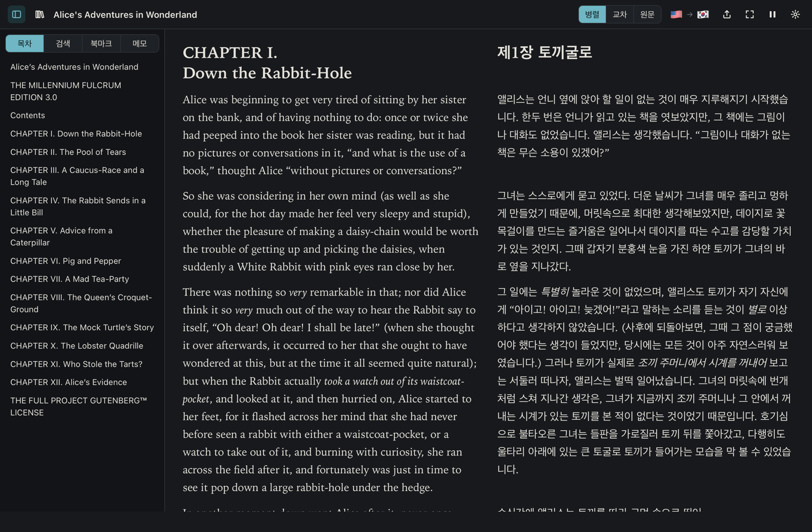

<p align="center">
  
</p>

<h1 align="center">Thoth Reader</h1>

A local-first macOS reader for PDF and EPUB books that shows a translation next to the original, paragraph by paragraph.

The name reads as **Th · o · th**: the same content on both sides of the *o*, once in the original language and once in yours.

Books, translations, notes and settings stay on your Mac. Text leaves the machine only when you point the app at a translation server yourself, and a local model (Ollama, LM Studio) keeps even that on the device.

> The interface is currently in Korean.



| Library | Original view |
| --- | --- |
|  |  |

<sub>Screenshots use public-domain books from [Project Gutenberg](https://www.gutenberg.org/); the Korean text was produced by a local model through LM Studio.</sub>

## Features

**Reading**

- PDF and EPUB library with covers, metadata, and sorting by recently read or title
- PDF: original layout, reflowed text, the book's own outline, thumbnails, zoom, fit width / fit page, in-book search
- EPUB: original rendering (scrolling or page turning, one or two columns) and a reflowed view
- Reading position restored per book; full-screen mode that shows only the page

**Translation**

- Side-by-side, interleaved, or translation-only views that keep you at the same paragraph when you switch
- Translates what you are reading first, then the surrounding pages in the background
- Sentences split by a page break are translated as one sentence
- Bold, italic and coloured emphasis are carried into the translation
- Edit any translated paragraph by hand, with history; re-translate or exclude paragraphs
- Translate just a selection without storing it
- Results are cached, so reopening a book makes no new requests

**Notes**

- Highlights in four colours and notes, on the original or the translation

**Export**

- Whole book, chapters, or a page range; untranslated paragraphs in the range are translated first, with progress and an estimated finish time
- PDF with the original page and the translated page side by side
- Typeset PDF of the translation (including the book's pictures), EPUB, HTML, Markdown, plain text

## Translation providers

| Provider | Notes |
| --- | --- |
| Ollama | Local. No key needed. |
| OpenAI-compatible API | Any server that speaks the Chat Completions API, including LM Studio and hosted services. API keys are stored in the macOS Keychain only. |

Add a provider in Settings, pick a model, and choose the target language. Translation-only models such as TranslateGemma or Hunyuan-MT use the *simple* request style and YanoljaNEXT Rosetta uses its own (*Rosetta*); both are selected automatically from the model name. General chat models use the *standard* style, which also sends the previous paragraph as context.

For a comparison of local models on English-to-Korean translation (speed, quality, and which request style each needs), see the [model benchmark (Korean)](docs/MODEL_BENCHMARK_KO.md). The app never falls back from a local provider to a remote one on its own.

## Install

Download the `.dmg` from the [Releases](https://github.com/ds5pnz/thoth_reader/releases) page, open it, and drag **Thoth Reader** to Applications.

Requirements: macOS 13 or later on Apple Silicon.

The build is not signed with an Apple Developer ID or notarized, so macOS blocks it on first launch. After copying it to Applications, remove the quarantine flag once:

```bash
xattr -dr com.apple.quarantine "/Applications/Thoth Reader.app"
```

## Keyboard

| Key | Action |
| --- | --- |
| `⌘O` | Open a book |
| `⌘F` | Search in the book |
| `⌘,` | Settings |
| `⌘+` / `⌘-` / `⌘0` | Zoom in / out / reset |
| `Space`, `→`, `Page Down` | Next page |
| `Shift+Space`, `←`, `Page Up` | Previous page |
| `Esc` | Leave full screen |

## Build from source

You need Node.js, Rust (see `rust-version` in `src-tauri/Cargo.toml`) and the Xcode command line tools.

```bash
npm install
```

```bash
npm run tauri dev
```

```bash
npm run app:build
```

The release build writes the app and disk image under `src-tauri/target/aarch64-apple-darwin/release/bundle/`.

### Tests

```bash
npm test
```

```bash
cd src-tauri && cargo test --lib
```

`scripts/selftest.sh` drives the real app window in a debug build against a scratch library; `scripts/mock_openai_server.py` stands in for a model.

## How it is built

- **Shell**: Tauri 2. The web view talks to Rust through explicitly allowed commands only.
- **Frontend**: React 19 and TypeScript, PDF.js for PDF, epub.js for EPUB.
- **Backend**: Rust with SQLite for the library, extracted text, translations, history and notes.
- **EPUB safety**: every EPUB is rewritten into a sanitized package before it is shown. Scripts never run, remote resources are dropped, and the book is displayed in a sandboxed frame.
- **Documents** are served to the web view over a private `thoth-doc://` protocol bound to the open session.

Design decisions are recorded in [docs/adr](docs/adr), and the current implementation status (in Korean) in [docs/STATUS.md](docs/STATUS.md).

## Known limitations

- Text in exported PDFs is rasterized, so it cannot be searched or copied.
- Scanned PDFs without a text layer are not supported (no OCR).
- The app is not code-signed or notarized.
- Apple Silicon only.

## License

No license has been chosen yet. Until one is added, all rights are reserved by the author.
