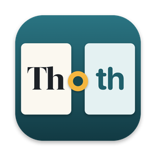
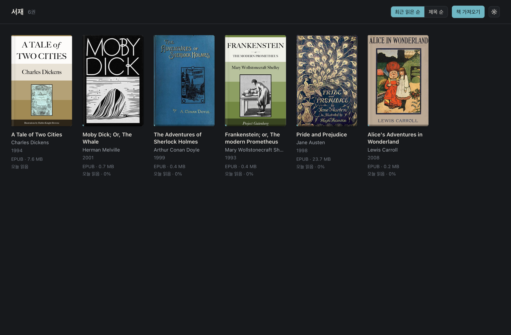
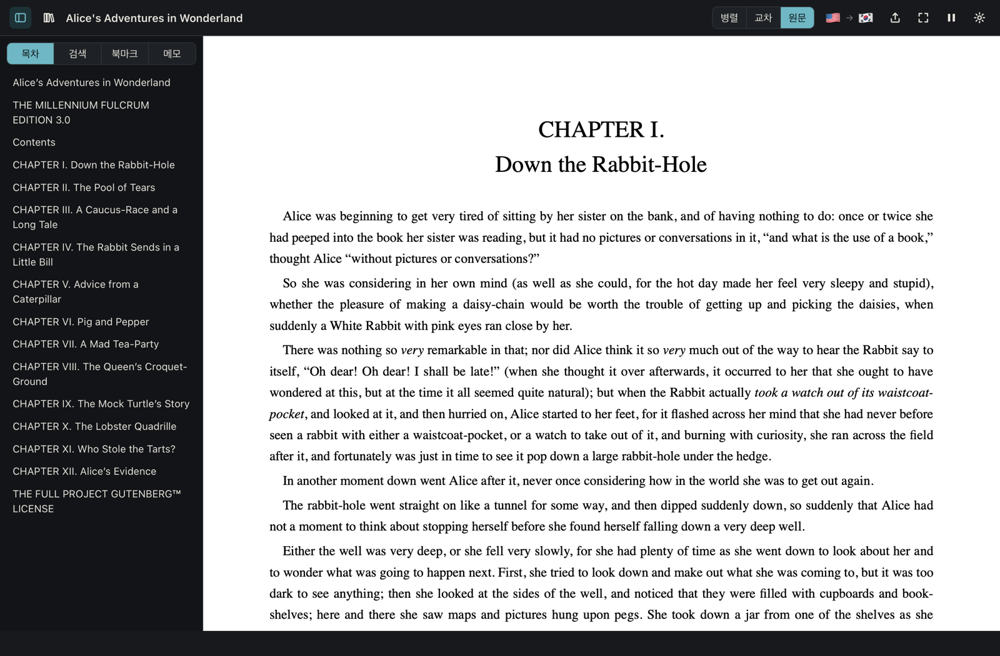

<p align="center">
  
</p>

<h1 align="center">Thoth Reader</h1>

PDF와 EPUB 책을 원문 옆에 번역문을 단락 단위로 나란히 보여 주는, 로컬 우선 리더입니다. macOS와 Windows에서 동작합니다.

이름은 **Th · o · th**로 읽습니다. *o*를 가운데 두고 양쪽에 같은 내용이 한 번은 원래 언어로, 한 번은 내 언어로 놓인다는 뜻입니다.

책, 번역, 메모, 설정은 모두 내 컴퓨터에 남습니다. 본문은 사용자가 직접 번역 서버를 지정했을 때만 밖으로 나가고, 로컬 모델(Ollama, LM Studio)을 쓰면 그것조차 기기 안에서 끝납니다.


| 서재 | 원문 보기 |
| --- | --- |
|  |  |

<sub>스크린숏은 [Project Gutenberg](https://www.gutenberg.org/)의 퍼블릭 도메인 도서를 사용했고, 한국어 번역문은 LM Studio의 로컬 모델이 만들었습니다.</sub>

## 기능

**읽기**

- 표지, 메타데이터, 최근 읽은 순·제목 순 정렬을 갖춘 PDF·EPUB 서재
- PDF: 원본 레이아웃, 쪽의 그림을 제자리에 둔 리플로우 보기, 책의 목차, 썸네일, 확대/축소, 너비 맞춤·쪽 맞춤, 책 안 검색
- EPUB: 원본 렌더링(스크롤 또는 쪽 넘김, 1단 또는 2단)과 리플로우 보기
- 책마다 읽던 위치 복원, 쪽만 보이는 전체 화면

**번역**

- 나란히 보기, 교차 보기, 번역만 보기. 보기를 바꿔도 같은 단락에 머물고, 번역만 보기에서는 단락을 클릭하면 원문이 보입니다
- 지금 읽는 부분을 먼저 번역하고, 앞뒤 쪽은 뒤에서 이어서 번역
- 쪽이 바뀌며 끊긴 문장은 한 문장으로 이어서 번역
- 굵게, 기울임, 색 강조를 번역문에도 반영
- 번역된 단락을 직접 고치기(이력 보관), 다시 번역하기, 번역에서 제외하기
- 선택한 부분만 저장하지 않고 번역
- 결과를 캐시하므로 책을 다시 열어도 새 요청이 나가지 않습니다

**메모**

- 원문과 번역문 어디에나 네 가지 색 형광펜과 메모

**내보내기**

- 책 전체, 장, 쪽 범위. 범위 안의 미번역 단락은 먼저 번역하며 진행률과 예상 완료 시각을 보여 줍니다
- 원본 쪽과 번역 쪽을 나란히 놓은 PDF
- 번역문을 조판한 PDF(책의 그림 포함), EPUB, HTML, Markdown, 일반 텍스트

## 번역 프로바이더

| 프로바이더 | 설명 |
| --- | --- |
| Ollama | 로컬. 키가 필요 없습니다. |
| OpenAI 호환 API | Chat Completions API를 지원하는 모든 서버. LM Studio와 호스팅 서비스를 포함합니다. API 키는 운영체제의 보안 저장소에만 저장됩니다. |
| ChatGPT 플랜 | **Continue with ChatGPT**로 로그인하면 ChatGPT 플랜에 포함된 사용량이나 크레딧으로 번역합니다. API 키가 필요 없습니다. 사용량과 앱별 한도는 ChatGPT 설정에서 관리하며, 한도에 닿으면 다른 과금 경로로 넘어가지 않고 번역을 멈춥니다. |
| Codex | 이 컴퓨터에 설치되어 로그인된 Codex를 사용합니다. 앱은 Codex의 인증 정보를 읽지 않으며, 도구·파일 접근·명령 실행을 끈 상태로 호출합니다. |

설정에서 프로바이더를 추가하고 모델과 번역 언어를 고르면 됩니다. TranslateGemma나 Hunyuan-MT 같은 번역 전용 모델은 *단순* 요청 형식을, YanoljaNEXT Rosetta는 전용 형식(*Rosetta*)을 쓰며, 둘 다 모델 이름을 보고 자동으로 선택됩니다. 일반 대화 모델은 앞 단락을 문맥으로 함께 보내는 *표준* 형식을 씁니다.

영어→한국어 번역에서 로컬 모델들의 속도와 품질, 모델별로 맞는 요청 형식을 비교한 내용은 [모델 벤치마크](docs/MODEL_BENCHMARK_KO.md)에 있습니다. 앱이 로컬 프로바이더에서 원격 프로바이더로 스스로 넘어가는 일은 없습니다. ChatGPT 플랜과 Codex는 번역할 단락을 OpenAI로 보냅니다.

API 키와 로그인 토큰은 macOS에서는 키체인에, Windows에서는 사용자 계정에 묶어 암호화한 파일에 저장됩니다.

## 설치

[Releases](https://github.com/ds5pnz/thoth_reader/releases) 페이지에서 내려받습니다.

### macOS

요구 사항: Apple Silicon, macOS 13 이상.

`.dmg`를 열고 **Thoth Reader**를 응용 프로그램 폴더로 끌어다 놓습니다.

Apple Developer ID 서명과 공증이 없어서 처음 실행할 때 macOS가 막습니다. 응용 프로그램 폴더에 복사한 뒤 격리 표시를 한 번 지워 주세요.

```bash
xattr -dr com.apple.quarantine "/Applications/Thoth Reader.app"
```

### Windows

요구 사항: Windows 10 또는 11 (x64).

`Thoth.Reader_<버전>_x64-setup.exe`를 실행합니다. 관리자 권한 없이 현재 사용자 계정에 설치됩니다. WebView2 런타임이 없으면 설치 프로그램이 내려받습니다.

코드 서명이 없어서 SmartScreen이 "Windows의 PC 보호" 경고를 띄웁니다. *추가 정보 → 실행*을 누르면 됩니다.

## 단축키

macOS 기준입니다. Windows에서는 `⌘` 대신 `Ctrl`을 씁니다.

| 키 | 동작 |
| --- | --- |
| `⌘O` | 책 열기 |
| `⌘F` | 책 안에서 검색 |
| `⌘,` | 설정 |
| `⌘+` / `⌘-` / `⌘0` | 확대 / 축소 / 원래 크기 |
| `Space`, `→`, `Page Down` | 다음 쪽 |
| `Shift+Space`, `←`, `Page Up` | 이전 쪽 |
| `Esc` | 전체 화면 나가기 |

## 소스에서 빌드하기

Node.js, Rust(`src-tauri/Cargo.toml`의 `rust-version` 참고), Xcode 명령줄 도구가 필요합니다.

```bash
npm install
```

```bash
npm run tauri dev
```

```bash
npm run app:build
```

릴리스 빌드는 앱과 디스크 이미지를 `src-tauri/target/aarch64-apple-darwin/release/bundle/` 아래에 만듭니다.

Windows(x64, MSVC 빌드 도구와 WebView2 필요)에서는 `npm run app:build:windows`가 설치 파일을 `src-tauri/target/release/bundle/nsis/` 아래에 만듭니다.

릴리스는 GitHub Actions에서 빌드합니다. 버전 태그(`v1.2.0`)를 푸시하면 macOS 디스크 이미지와 Windows 설치 파일을 빌드해 그 태그의 릴리스에 첨부합니다. [docs/releases](docs/releases)를 참고하세요.

### 테스트

```bash
npm test
```

```bash
cd src-tauri && cargo test --lib
```

`scripts/selftest.sh`는 디버그 빌드의 실제 앱 창을 임시 서재로 구동하고, `scripts/mock_openai_server.py`는 모델 서버를 대신합니다.

## 구조

- **셸**: Tauri 2. 웹뷰는 명시적으로 허용한 명령으로만 Rust와 통신합니다.
- **프런트엔드**: React 19와 TypeScript. PDF는 PDF.js, EPUB은 epub.js.
- **백엔드**: Rust와 SQLite. 서재, 추출한 본문, 번역, 이력, 메모를 저장합니다.
- **EPUB 안전성**: 모든 EPUB은 보여 주기 전에 정화된 패키지로 다시 씁니다. 스크립트는 실행되지 않고, 원격 리소스는 제거되며, 책은 샌드박스 프레임 안에 표시됩니다.
- **문서**는 열린 세션에 묶인 전용 `thoth-doc` 프로토콜로 웹뷰에 제공됩니다.

설계 결정은 [docs/adr](docs/adr)에, 현재 구현 상태는 [docs/STATUS.md](docs/STATUS.md)에 기록되어 있습니다.

## 알려진 제한

- 내보낸 PDF의 글자는 이미지로 들어가서 검색과 복사가 되지 않습니다.
- 텍스트 레이어가 없는 스캔 PDF는 지원하지 않습니다(OCR 없음).
- 앱에 코드 서명과 공증이 없습니다.
- macOS 빌드는 Apple Silicon 전용입니다.
- Windows 빌드는 새로 추가되었습니다. GitHub의 Windows 장비에서 자동으로 빌드하고 실행해 확인했지만(책 열기, 번역, 모든 보기의 렌더링), 사람이 Windows PC에서 직접 써 본 적은 아직 없습니다.

## 라이선스

아직 라이선스를 정하지 않았습니다. 추가되기 전까지 모든 권리는 저작자에게 있습니다.
